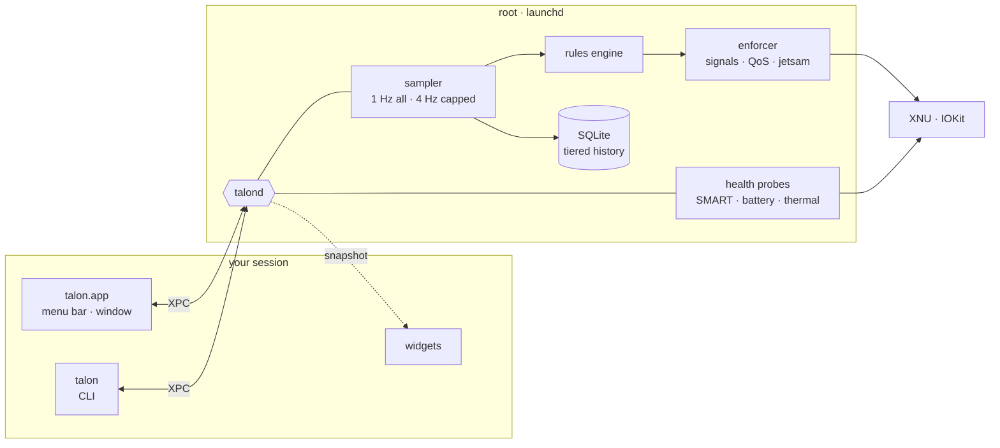

<p align="center">
  <picture>
    <source media="(prefers-color-scheme: dark)" srcset="assets/banner-dark.svg">
    <source media="(prefers-color-scheme: light)" srcset="assets/banner-light.svg">
    
  </picture>
</p>

<p align="center">
  
  
  
  
  
</p>

<p align="center">
  <b>Put a ceiling on anything. See what wears your hardware. Keep this Mac healthy for years.</b><br>
  <sub>A personal control panel for a fanless M5 MacBook Air — native, quiet, and as polished as the machine it runs on.</sub>
</p>

<p align="center">
  <a href="#what-talon-does">What it does</a> ·
  <a href="#proven-on-the-metal">Phase 0 results</a> ·
  <a href="#architecture">Architecture</a> ·
  <a href="#roadmap">Roadmap</a> ·
  <a href="#run-the-spikes">Run it</a>
</p>

<br>

## What talon does

<table>
  <tr>
    <td width="33%" valign="top">
      <h3>Ceilings</h3>
      Give any app, process or experiment a limit on memory, CPU or disk I/O — and decide, per rule, how hard talon holds the line.
    </td>
    <td width="33%" valign="top">
      <h3>Health</h3>
      Battery capacity and cycles, SSD wear and bytes written, 39 temperature sensors, thermal throttling, swap and memory pressure — with history going back months.
    </td>
    <td width="33%" valign="top">
      <h3>Care</h3>
      Specific, honest advice: what is writing to your SSD, when the battery has been parked at 100 % too long, what was running when the chip throttled.
    </td>
  </tr>
</table>

### You choose how strict each ceiling is

| Level | When a ceiling is crossed |
|---|---|
| **Watch** | Mark it on the chart. Nothing else. |
| **Warn** | Send a notification. |
| **Ask** | A small glass panel: *raise the ceiling*, *pause*, or *quit*. |
| **Slow down** | Move it to the efficiency cores and throttle its disk I/O. |
| **Pause** | Freeze it in place. One click resumes it. |
| **Quit** | Ask it to quit; force-quit after a grace period. |
| **Hard cap** | The kernel enforces it. The process can never exceed the ceiling. |

Every rule also has a warning threshold and a grace period, so a one-second spike never kills your work. The signature interaction: set a ceiling by **dragging a line across the app's live chart**, with a haptic tick as you cross its current usage.

### For experiments

```bash
talon run --mem 6G --cpu 200% --strict ask -- python train.py   # planned CLI
```

A hard memory ceiling on the command and a shared budget across every worker it spawns.

<br>

## Proven on the metal

Before writing the app, every risky piece was tested on the actual machine — an M5 MacBook Air (4 Super + 6 Efficiency cores, 16 GB, 512 GB) on macOS 27. Full write-up: [`spikes/FINDINGS.md`](spikes/FINDINGS.md).

| Question | Answer |
|---|---|
| Can it watch every process without becoming the problem? | **Yes.** A full sweep of ~680 processes costs **0.35 % CPU** at 1 Hz, with 2 MB of memory. Capped apps get a faster 4 Hz lane. |
| Can memory be hard-capped on macOS? | **Yes.** Set at launch, the kernel killed a runaway process at **275 MB of a 300 MB ceiling** — no admin needed. Running apps can be capped through the helper. |
| Is the soft cap fast enough? | **Yes.** Against memory growing at ~400 MB/s, the watchdog overshot by at most one 25 MB step. |
| Can it see heat on a fanless Mac? | **Yes.** 39 sensors, macOS's thermal pressure level, and live clock speed per cluster (E-cores 3048 MHz, Super cores 4464 MHz). |
| Can it read SSD and battery health directly? | **Yes.** NVMe SMART and the battery controller, no third-party tools. |
| Can a root helper be safe? | **Yes.** `talond` serves one user ID, refuses system processes, and hard-capped a running app over XPC. |

<details>
<summary><b>What phase 0 changed in the design</b></summary>
<br>

- Kernel memory limits are **per process**, not inherited by children — so experiments get a process-tree budget enforced by talon itself.
- Sweeping every process 4× a second cost 1.5 % CPU — so sampling is **tiered**: 1 Hz for everything, faster only for capped apps.
- IOReport CPU energy counters read **zero on macOS 27** — so power comes from the battery's own telemetry instead.
- The older `SET_JETSAM_TASK_LIMIT` call is rejected on macOS 27 — talon uses `SET_MEMLIMIT_PROPERTIES`.

</details>

<details>
<summary><b>This Mac today</b> · November 2026</summary>
<br>

| | Reading | Verdict |
|---|---|---|
| Battery | 97 cycles · 97 % (Apple) · 93.2 % raw nominal | Healthy — ~10 % of its 1,000-cycle rating |
| SSD | 0 % wear · 12.08 TB written · 0 media errors · 100 % spare | Healthy — roughly 1–4 % of expected endurance |
| Memory | 0.9 GB swap on 16 GB | Normal |
| Storage | 231 GB free | Plenty |
| Thermals | Nominal pressure · die 38 → 50 °C under a short full load | As designed |

Deeper analysis: [`docs/reports/macbook-air-m5-health.md`](docs/reports/macbook-air-m5-health.md).

</details>

<br>

## Architecture



History is kept the way a careful TSDB would keep it: the last hour lives in memory, older data is rolled up into 10-second, 1-minute and hourly tiers, and writes are batched — so a tool meant to protect the SSD doesn't wear it.

### Stack

| Layer | Choice |
|---|---|
| Language | Swift 6.4, plus a thin C / Objective-C shim for private headers |
| Interface | SwiftUI, with AppKit for the menu bar panel and the live process table |
| Charts | Swift Charts on pre-downsampled series |
| Storage | SQLite via GRDB, owned by `talond` |
| IPC | XPC over a launchd Mach service |
| Build | One Swift package for the core, daemon and CLI · XcodeGen for the app and widget |

Why this stack, and what was ruled out: [`docs/reports/talon-stack-choice.md`](docs/reports/talon-stack-choice.md).

<br>

## Roadmap

- [x] **Phase 0** — prove the risky parts on this Mac
- [x] **Research** — language and stack, and the hardware itself
- [ ] **Phase 0.5** — settle the open questions: XPC peer requirements, widgets under personal signing, live-table and chart performance, a 24-hour write soak
- [ ] **Phase 1** — `talond`, the sampler, tiered history, the menu bar panel, Overview and Processes
- [ ] **Phase 2** — ceilings, the strictness ladder, drag-to-set, `talon run`
- [ ] **Phase 3** — Health and History
- [ ] **Phase 4** — Care, notifications, widgets, charge-limit awareness
- [ ] **Phase 5** — motion, haptics, accessibility, the last 10 %

<br>

## Run the spikes

```bash
cd spikes
./build.sh

./1-sampler/sampler --hz 1 --fast-hz 4 --watch 5   # sweep every process, report overhead
./2-memcap/memcap 300                              # hard and soft memory ceilings
./3-thermal/thermal                                # sensors, pressure, clocks (try: thermal 300)
./4-health/health                                  # SSD SMART + battery

sudo ./root-tests.sh                               # installs talond, tests it, removes it
```

## Repository

```
talon/
├── assets/              banner art
├── docs/
│   ├── reports/         stack choice · M5 Air health and longevity
│   └── research/        the notes behind the reports
└── spikes/              phase 0 — every risky API, tested on this Mac
    ├── 1-sampler/       process sweep and overhead
    ├── 2-memcap/        hard and soft memory ceilings
    ├── 3-thermal/       sensors, thermal pressure, live clocks
    ├── 4-health/        NVMe SMART and battery
    ├── 5-helper/        talond — root daemon over XPC
    ├── build.sh
    ├── root-tests.sh
    └── FINDINGS.md
```

## Principles

- **Never the problem it solves.** Under 1 % CPU, a few MB of memory, minimal SSD writes.
- **Safe by construction.** The helper only acts on your own processes, refuses system ones, accepts typed commands only, and every pause can be undone.
- **Honest numbers.** Apple's figures where they exist, raw values beside them, and a clear line between measured and estimated.
- **Native or nothing.** No web views. Liquid Glass, SF Symbols, spring animations, real haptics.

<br>

<p align="center">
  <sub><b>talon</b> — the claw of a bird of prey. It grips hard, and lets go exactly when it should.</sub><br>
  <sub>A personal project, built for exactly one Mac.</sub>
</p>
