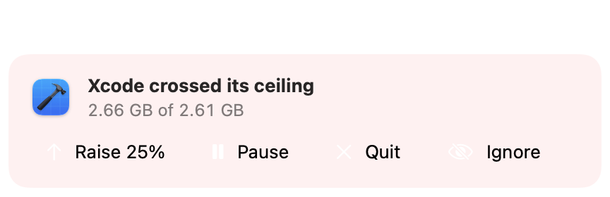
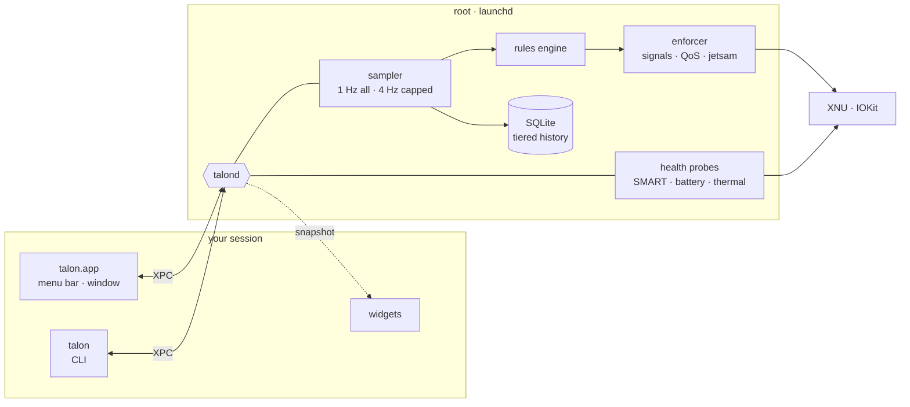

<p align="center">
  <picture>
    <source media="(prefers-color-scheme: dark)" srcset="assets/banner-dark.svg">
    <source media="(prefers-color-scheme: light)" srcset="assets/banner-light.svg">
    
  </picture>
</p>

<p align="center">
  
  
  
  
  
</p>

<p align="center">
  <b>Put a ceiling on anything. See what wears your hardware. Reclaim space with a scalpel. Keep this Mac healthy for years.</b><br>
  <sub>A personal control panel for a fanless M5 MacBook Air — native, quiet, and as polished as the machine it runs on.</sub>
</p>

<p align="center">
  <a href="#what-talon-does">What it does</a> ·
  <a href="#proven-on-the-metal">Phase 0 results</a> ·
  <a href="#architecture">Architecture</a> ·
  <a href="#roadmap">Roadmap</a> ·
  <a href="#the-app">The app</a> ·
  <a href="#build-and-run">Run it</a>
</p>

<br>

## What talon does

<table>
  <tr>
    <td width="25%" valign="top">
      <h3>Ceilings</h3>
      Give any app, process or experiment a limit on memory, CPU or disk I/O — and decide, per rule, how hard talon holds the line.
    </td>
    <td width="25%" valign="top">
      <h3>Health</h3>
      Battery capacity and cycles, SSD wear and bytes written, 39 temperature sensors, thermal throttling, swap and memory pressure — with history going back months.
    </td>
    <td width="25%" valign="top">
      <h3>Care</h3>
      Specific, honest advice: what is writing to your SSD, when the battery has been parked at 100 % too long, what was running when the chip throttled.
    </td>
    <td width="25%" valign="top">
      <h3>Scalpel</h3>
      Surgical storage cleanup: the exact space each cut gives back, what it is, what it costs to remove — and every cut reversible.
    </td>
  </tr>
</table>

### You choose how strict each ceiling is

| Level | When a ceiling is crossed |
|---|---|
| **Watch** | Mark it on the chart. Nothing else. |
| **Warn** | Send a notification. |
| **Ask** | A small glass panel: *raise the ceiling*, *pause*, or *quit*. |
| **Slow down** | Move it to the efficiency cores and throttle its disk I/O. |
| **Pause** | Freeze it in place. One click resumes it. |
| **Quit** | Ask it to quit; force-quit after a grace period. |
| **Hard cap** | The kernel enforces it. The process can never exceed the ceiling. |

Every rule also has a warning threshold and a grace period, so a one-second spike never kills your work, and a release delay, so a slowed-down app isn't let go the moment it dips under. The signature interaction: set a ceiling by **dragging a line across the app's live chart**, with a haptic tick as you cross its current usage.

```bash
talon ceiling add Xcode --mem 8G --strict ask         # the glass panel asks: raise 25 %, pause, quit, or ignore
talon ceiling add Safari --cpu 150% --strict slow     # efficiency cores and throttled I/O while it's over
talon ceiling add 4242 --mem 2G --strict quit --grace 10s
talon ceiling                                         # every ceiling, live usage, state, last action
```

<p align="center">
  <picture>
    <source media="(prefers-color-scheme: dark)" srcset="docs/screenshots/ask-dark.png">
    
  </picture>
</p>

### For experiments

```bash
talon run --mem 6G -- python train.py                                  # kernel ceiling on the command, no admin
talon run --tree-mem 10G --cpu 400% --strict quit -- python train.py   # one budget for every worker it spawns
```

`--mem` is a kernel limit on the command itself. `--tree-mem` and `--cpu` are a budget shared by the whole process tree, enforced by talon at 4 Hz with the same engine `talond` uses — no daemon needed.

### scalpel: storage, cut precisely

Most cleaners guess. They add up folder sizes that double-count APFS clones, wipe caches that refill an hour later, and hide what they removed. scalpel measures the **space you would actually get back** (clone-aware, hard-link-aware, snapshot-aware), and explains each item before you touch it: what it is, which app made it, when it was last used, and what happens after it's gone.

| | |
|---|---|
| **Finds** | Xcode DerivedData and simulators, package-manager caches, Docker disks, AI models, stale `node_modules`, leftovers from deleted apps, installer debris, duplicates, large untouched files, snapshot-held space |
| **Cuts** | Into a 7-day holding area, restorable in one click. Uses each app's own cleanup tool where one exists. Never touches system paths. |
| **Protects** | Warns when clearing a cache would just cost SSD writes to rebuild it. Replaces duplicates with APFS clones instead of deleting. |
| **Watches** | Free-space forecast, the folders growing fastest, runaway logs and caches |

```bash
talon scalpel scan ~                          # map + findings, what each cut would really give back
talon scalpel why ~/Library/Developer         # explain one path
talon scalpel clean --tier safe               # dry run; add --yes to move it to the holding area
talon scalpel holding                         # what's held, restore <id>, purge
```

Design: [`docs/scalpel.md`](docs/scalpel.md).

<br>

## Proven on the metal

Before writing the app, every risky piece was tested on the actual machine — an M5 MacBook Air (4 Super + 6 Efficiency cores, 16 GB, 512 GB) on macOS 27. Full write-up: [`spikes/FINDINGS.md`](spikes/FINDINGS.md).

| Question | Answer |
|---|---|
| Can it watch every process without becoming the problem? | **Yes.** A full sweep of ~680 processes costs **0.35 % CPU** at 1 Hz, with 2 MB of memory. Capped apps get a faster 4 Hz lane. |
| Can memory be hard-capped on macOS? | **Yes.** Set at launch, the kernel killed a runaway process at **275 MB of a 300 MB ceiling** — no admin needed. Running apps can be capped through the helper. |
| Is the soft cap fast enough? | **Yes.** Against memory growing at ~400 MB/s, the watchdog overshot by at most one 25 MB step. |
| Can it see heat on a fanless Mac? | **Yes.** 39 sensors, macOS's thermal pressure level, and live clock speed per cluster (E-cores 3048 MHz, Super cores 4464 MHz). |
| Can it read SSD and battery health directly? | **Yes.** NVMe SMART and the battery controller, no third-party tools. |
| Can a root helper be safe? | **Yes.** `talond` serves one user ID, refuses system processes, and hard-capped a running app over XPC. |

<details>
<summary><b>What phase 0 changed in the design</b></summary>
<br>

- Kernel memory limits are **per process**, not inherited by children — so experiments get a process-tree budget enforced by talon itself.
- Sweeping every process 4× a second cost 1.5 % CPU — so sampling is **tiered**: 1 Hz for everything, faster only for capped apps.
- IOReport CPU energy counters read **zero on macOS 27** — so power comes from the battery's own telemetry instead.
- The older `SET_JETSAM_TASK_LIMIT` call is rejected on macOS 27 — talon uses `SET_MEMLIMIT_PROPERTIES`.

</details>

<details>
<summary><b>This Mac today</b> · November 2026</summary>
<br>

| | Reading | Verdict |
|---|---|---|
| Battery | 97 cycles · 97 % (Apple) · 93.2 % raw nominal | Healthy — ~10 % of its 1,000-cycle rating |
| SSD | 0 % wear · 12.08 TB written · 0 media errors · 100 % spare | Healthy — roughly 1–4 % of expected endurance |
| Memory | 0.9 GB swap on 16 GB | Normal |
| Storage | 231 GB free | Plenty |
| Thermals | Nominal pressure · die 38 → 50 °C under a short full load | As designed |

Deeper analysis: [`docs/reports/macbook-air-m5-health.md`](docs/reports/macbook-air-m5-health.md).

</details>

<br>

## Architecture



History is kept the way a careful TSDB would keep it: the last hour lives in memory, older data is rolled up into 10-second, 1-minute and hourly tiers, and writes are batched — so a tool meant to protect the SSD doesn't wear it.

### Stack

| Layer | Choice |
|---|---|
| Language | Swift 6.4, plus a thin C / Objective-C shim for private headers |
| Interface | SwiftUI, with AppKit for the menu bar panel and the live process table |
| Charts | Swift Charts on pre-downsampled series |
| Storage | SQLite via GRDB, owned by `talond` |
| IPC | XPC over a launchd Mach service |
| Build | One Swift package for the core, daemon and CLI · XcodeGen for the app and widget |

Why this stack, and what was ruled out: [`docs/reports/talon-stack-choice.md`](docs/reports/talon-stack-choice.md).

<br>

## Roadmap

- [x] **Phase 0** — prove the risky parts on this Mac
- [x] **Research** — language and stack, and the hardware itself
- [ ] **Phase 0.5** — settle the open questions: XPC peer requirements, widgets under personal signing, live-table and chart performance, a 24-hour write soak, scalpel scan speed and exact-reclaim accuracy
- [ ] **Phase 1** — `talond`, the sampler, tiered history, the menu bar panel, Overview and Processes
  - [x] TalonKit package: C shim, model, IPC schema, sensors, sampler, tiered aggregator, policy
  - [x] `talond`: 1 Hz sweep, SQLite history (10 s / 1 min / 1 h + events), XPC, cap / freeze / thaw
  - [x] `talon` CLI: `status`, `top`, `health`, `run --mem`, `cap`, `freeze`, `history`, `apps`, `events`
  - [x] Menu bar panel, Overview and Processes (XcodeGen app on an AppKit spine)
  - [ ] Run the app against a live `talond` (agent or root daemon) and tune it on real data
- [ ] **Phase 2** — ceilings, the strictness ladder, drag-to-set, `talon run`
  - [x] Ceiling engine: all seven rungs, warn line, grace, release hysteresis, Ask answers — pure and unit-tested
  - [x] `talond`: persisted ceilings, 4 Hz fast lane for memory, every action policy-checked and logged
  - [x] CLI: `talon ceiling add · list · rm · toggle · answer`, `talon run --tree-mem --cpu --strict`
  - [x] App: Ceilings pane, drag-to-set with a haptic tick, strictness ladder, ask panel, notifications
  - [ ] Try drag, haptics, notifications and the ask panel with a live `talond` on this Mac
- [x] **Phase 3** — Health and History
  - [x] Per-cluster CPU clocks from IOReport and a throttling signal (P-cluster clock ÷ max while busy), throttling events naming the busiest apps
  - [x] Daily battery and SSD records, unsafe-shutdown events, per-app history, `talon health --trend`, `talon app <name>`
  - [x] History pane: battery-health and SSD-writes-per-day trends, one app over time, a filterable event timeline
- [x] **Phase 4** — scalpel: exact-reclaim scanner, findings, holding area, growth watch
  - [x] `getattrlistbulk` scanner: clone-, hard-link- and firmlink-aware; a full home scan (1.6 M files) in ~24 s on one core's worth of kernel time
  - [x] Findings across every category in the design, tiered and explained; holding area with restore and purge; duplicate → APFS clone
  - [x] `talon scalpel scan · why · clean · holding · restore · purge · dedupe` (dry-run unless `--yes`), and a Scalpel pane with a treemap sized by reclaimable bytes
  - [x] Growth watch: the free-space forecast lives in Care
- [x] **Phase 5** — Care, notifications, widgets, charge-limit awareness
  - [x] Care: SSD wear and top writers, battery parked at 95–100 % on the charger, swap, throttling, free-space forecast, unsafe shutdowns, battery wear — `talon care`, a Care pane, a line in the panel, a notification per "act" item at most weekly
  - [x] Widget (small and medium) fed by a snapshot file; whether WidgetKit loads it under ad-hoc signing is untested
- [x] **Phase 6** — motion, haptics, accessibility, the last 10 %
  - [x] Spring panel that honours Reduce Motion, solid panel under Reduce Transparency, animated numbers, haptics on the ceiling line and the strictness ladder
  - [x] VoiceOver: spoken chart summaries, a ceiling adjustable with ↑/↓, labelled status item and process rows; ⌘1–6 panes, Esc closes the panel, ⌘, Settings
  - [x] App icon, open-at-login switch in Settings

<br>

## The app

<p align="center">
  <picture>
    <source media="(prefers-color-scheme: dark)" srcset="docs/screenshots/panel-dark.png">
    
  </picture>
  <br><sub>The menu bar panel (rendered with <code>--demo</code> data).</sub>
</p>

A bird in the menu bar that stays quiet until something needs attention: it turns orange under memory or thermal pressure or an approaching ceiling, red when either is critical or a ceiling is waiting for an answer. Click it for the panel: six live readings with the last five minutes behind each, and the top apps. The window has six panes (⌘1–6): **Overview** (history from 15 minutes to 30 days with min–max bands, P-cluster speed, health cards, who wrote to the SSD today), **Care**, **Processes** (every process grouped under its app, with pause, resume and ceilings from the context menu), **Ceilings**, **History** (battery and SSD trends, one app over time, the event timeline) and **Scalpel**.

The app links only `TalonModel` and `TalonIPC`. Every number comes from `talond` over XPC, so it never needs sensors, private APIs or the database.

```bash
make app        # build .build/app/Build/Products/Release/Talon.app
make app-demo   # run it on synthetic data, window open, labelled DEMO DATA
make snapshots  # render panel, Overview and Processes (light + dark) to PNGs, no screen access needed
```

## Build and run

Needs Xcode 27 (Swift 6.4). Everything below runs as you; only `sudo make install` needs admin.

```bash
make                       # release build of talon + talond, ad-hoc signed
make test                  # 85+ tests, incl. real XPC, kernel ceilings, and ceilings pausing / quitting real processes

.build/release/talon                      # status: CPU, memory, swap, thermals, power, free space
.build/release/talon top --sort disk      # who's writing to the SSD right now, grouped by app
.build/release/talon health               # battery, SSD SMART, 37 sensors, cluster clocks — straight from the hardware
.build/release/talon run --mem 2G -- cmd  # kernel memory ceiling at launch, no admin
```

History, ceilings, `cap`, `freeze` and `apps` talk to `talond`. Run it one of two ways:

| | Command | Sees | Can |
|---|---|---|---|
| **User agent** | `make agent` · `make unagent` | your processes | history, ceilings (Hard cap falls back to stopping the largest process), freeze / thaw |
| **Root daemon** | `make build && sudo make install` · `sudo make uninstall` | every process | all of that, plus kernel ceilings on running apps |

```bash
talon daemon                          # is it running, and what does it cost?
talon history cpuTemp --range 24h     # sparkline + min / avg / max from the tiered history
talon apps --range 7d --by disk       # which apps wrote the most
talon app Xcode --range 7d            # one app's memory, CPU and writes over time
talon health --trend                  # battery capacity, cycles and SSD writes per day, from daily records
talon care                            # the few things worth doing, most important first
talon freeze 4242 && talon thaw 4242  # pause in place; talond resumes it if talond ever exits
talon cap 4242 --mem 2G               # root daemon only
make logs                             # follow talond's log
```

Measured on this Mac: release `talond` costs **~0.5 % CPU and 5.6 MB** sweeping ~570 processes once a second with every sensor on, and commits history once a minute.

<details>
<summary><b>What building phase 1 changed</b></summary>
<br>

- `PowerTelemetryData.SystemLoad` goes stale on battery (0.5 W while the pack supplied 3.6 W), so system power is voltage × current, minus what goes into the battery when plugged in.
- The per-app minute table holds the top 40 apps by CPU, by memory *and* by writes, so ~80–110 rows a minute here rather than 40.
- The daemon's logic lives in a library (`TalonDaemon`), so tests drive the real request handling over a real anonymous XPC connection without launchd or root.
- Phase 3: `HOST_CPU_LOAD_INFO` updates in coarse steps on macOS 27 (identical reads 200 ms apart), so system CPU comes from the per-processor counters, which advance smoothly.
- Phase 2: `getpriority()` doesn't report Darwin background state, but the scheduler priority does (31 → 4 when slowed down), so that's what tests check.

</details>

### The phase 0 spikes

```bash
cd spikes && ./build.sh
./1-sampler/sampler --hz 1 --fast-hz 4 --watch 5   # sweep every process, report overhead
./2-memcap/memcap 300                              # hard and soft memory ceilings
./3-thermal/thermal                                # sensors, pressure, clocks (try: thermal 300)
./4-health/health                                  # SSD SMART + battery
sudo ./root-tests.sh                               # installs the spike helper, tests it, removes it
```

### Spike results that changed scalpel

- `ATTR_CMNEXT_LINKID` is per hard-link *name*, and every name reports the full private size — so hard links are grouped by inode, not link id.
- `PRIVATESIZE` predicted the space actually freed to the MiB in every clone test; it's also the one expensive attribute (~70 % of kernel time), so scans run two workers at utility priority.
- No space-per-snapshot figure is readable without admin; scalpel shows it as unknown rather than guessing.
- The leftover matcher's first run had 2 false positives in 19 (a macOS printing component, a library inside an installed app); both classes are now excluded.

Details: [`docs/scalpel.md`](docs/scalpel.md#spike-results).

## Repository

```
talon/
├── Package.swift        TalonKit: libraries + talond + talon
├── Makefile             build · test · sign · agent · install · logs
├── Sources/
│   ├── TalonPrivate/    C shim: memorystatus, jetsam spawn, responsible pid, HID temps, NVMe SMART
│   ├── TalonModel/      Sendable value types shared by everything (and later the app)
│   ├── TalonIPC/        TalonRequest / TalonReply, the wire codec, the XPC client
│   ├── TalonSensors/    processes, memory, CPU, disk, thermal, battery, SSD
│   ├── TalonCore/       sampler, tiered aggregator, policy, enforcer, capped launcher
│   ├── TalonStore/      GRDB schema, tiers, retention (daemon-only)
│   ├── TalonDaemon/     talond's state, request handling, XPC listener
│   ├── TalonScalpel/    storage scanner, findings, holding area, dedupe (runs as you, never as root)
│   ├── talond/          the helper's entry point
│   └── talon/           the CLI
├── Tests/TalonTests/    Swift Testing: units, policy table, store, codec, live sensors, XPC
├── App/
│   ├── project.yml      XcodeGen spec (the .xcodeproj is generated, not committed)
│   ├── TalonApp/        menu bar panel; Overview, Care, Processes, Ceilings, History, Scalpel; ask panel; demo source; snapshots
│   ├── TalonWidget/     small and medium widget, fed by /Users/Shared/Talon/widget.json
│   └── tools/           app icon generator
├── launchd/             LaunchDaemon and LaunchAgent plists
├── assets/              banner art
├── docs/
│   ├── scalpel.md       storage analyser and cleaner design
│   ├── reports/         stack choice · M5 Air health and longevity
│   └── research/        the notes behind the reports
└── spikes/              every risky API, tested on this Mac (phase 0, plus 6-scalpel)
```

## Principles

- **Never the problem it solves.** Under 1 % CPU, a few MB of memory, minimal SSD writes.
- **Safe by construction.** The helper only acts on your own processes, refuses system ones, accepts typed commands only, and every pause can be undone.
- **Honest numbers.** Apple's figures where they exist, raw values beside them, and a clear line between measured and estimated.
- **Native or nothing.** No web views. Liquid Glass, SF Symbols, spring animations, real haptics.

<br>

<p align="center">
  <sub><b>talon</b> — the claw of a bird of prey. It grips hard, and lets go exactly when it should.</sub><br>
  <sub>A personal project, built for exactly one Mac.</sub>
</p>
